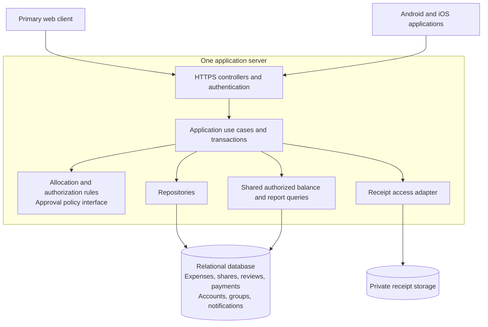

# Architecture B: Layered Application with Derived Balances

## 1. Overview and rationale

This alternative is based on the [original SplitSmart requirements](../../UserRequirement.md) and the lab's [generated specification](../../specs/001-splitsmart-specification/spec.md). These are its requirements sources. Technology and design choices below are proposals, not additional customer requirements.

Use a **three-tier application**: web and mobile presentation, one application server organized around use cases, and a relational database. Within the server, request controllers invoke application procedures that use shared validation, policy functions, and repositories. Organize the code by these layers rather than separate feature services.

The distinguishing financial choice is to **derive balances directly from approved expense shares and recorded payments**. There is no separately maintained balance table, financial-posting subsystem, or asynchronous balance projection. Approval changes an expense's status atomically; subsequent balance queries include that expense. This is a meaningful alternative to component organization around separate expense, review, financial-posting, and reporting modules. It can be assessed independently without depending on Architecture A's implementation.

This approach suits a student project: one server, one database, ordinary database transactions, and a small set of explicit use cases. It prioritizes understandable financial rules and reduces the number of representations that must stay synchronized. It does not claim a measured performance advantage.

## 2. Components and responsibilities

| Layer/component | Responsibilities |
|---|---|
| Primary web client | Account, group, expense, review, notification, balance, payment, and report screens; receipt selection and understandable validation feedback. |
| Android/iOS application | The same journeys through a shared mobile codebase packaged as applications for both platforms. A responsive website alone does not fulfill this requirement. |
| HTTP controllers and authentication | Establish authenticated identity, parse requests, call use cases, and return consistent success/failure responses. |
| Application procedures | Implement register/login, manage group, submit expense, review expense, record payment, read notifications, and view summaries; establish transaction boundaries and enforce authorization. |
| Shared rule functions | Validate equal/percentage allocations, monetary precision, review eligibility/completion, and action/resource visibility. Keep unresolved policies behind explicit interfaces. |
| Repositories and query definitions | Persist records and execute authorized balance/report queries. One shared financial query definition prevents reports and balance screens from using different arithmetic. |
| Private receipt storage | Store optional images outside public web content; release them only following server authorization. |

For example, the server could use `controllers/`, `application/`, `rules/`, and `persistence/` directories. A conventional framework and PostgreSQL are reasonable implementation choices; no particular language or version is required by the sources. No service broker or independently deployed feature services are necessary.

## 3. Interactions and data flow

### Expense submission and notices

1. A signed-in client submits amount, date, description, payer, participants, split method, and optional group/receipt.
2. The application checks permission and validates positive amounts, unique participants, percentage totals, and exact allocation totals. Individual expenses may omit a group.
3. If an image is supplied, validate and stage it privately before committing the submission. A failed upload/save returns a failure; it must not claim successful submission. Remove abandoned staged images through routine cleanup.
4. In one database transaction, save the pending expense, its participant allocations, optional receipt metadata, and one notification record for each other current group member. Capture the recipient set during submission so later membership changes do not alter which members were notified.
5. Return success after commit. Pending expenses appear as pending and contribute zero to balances.

A persisted in-app notification list retrieved by the clients is the proposed minimal notification channel. Channel, timing, and failure expectations remain OQ-004; this choice requires agreement before final acceptance. It does not presume email or push delivery. Notification content and subsequent access must also comply with OQ-009.

### Review

The review procedure authorizes the reviewer through the agreed policy and locks the expense row. It records the decision and evaluates completion in the same transaction. Only a completed approval changes status to approved. Partial reviews and declined expenses remain excluded from balances. Repeated requests return the already-recorded outcome; concurrent reviews serialize on the expense. A request identifier prevents retrying a decision from inserting it again.

Policy functions can evaluate one review or multiple levels without introducing a general workflow engine or a user-facing configuration feature. Reviewer roles, self-approval, level completion, and treatment of policy changes remain OQ-007/OQ-008. Individual expenses also require an agreed review policy.

### Payments, balances, and reports

The payment procedure validates and authorizes an already-made settlement, then inserts one payment using a unique request identifier. A retry retrieves that record; reuse with different content is rejected. The application does not transfer money.

Balance requests read committed approved expenses and payments through a common relational query. Reports use the same definitions and a consistent database snapshot when several queries form one response. Pending/declined expenses may appear in authorized expense lists with explicit states, but never in financial totals. Clients refresh saved data to obtain matching results across platforms.

## 4. Database and persistence design

Use one transactional relational database with foreign keys, required fields, positive-amount constraints, and uniqueness constraints.

| Table | Principal data and constraints |
|---|---|
| `users` | User identity and securely hashed authentication credentials; registration identity remains OQ-006. |
| `groups`, `memberships` | Group name and user associations, including membership history sufficient to preserve attribution. Membership does not itself grant unspecified management rights. |
| `expenses` | Payer, optional group, amount, date, description, split method, review status, submitter, and unique submission request identifier. |
| `expense_shares` | Expense/user key, submitted percentage where relevant, and final allocated amount; one row per participant. |
| `review_decisions` | Expense, reviewer, outcome, applicable level where required, timestamp, and unique review request identifier. Final policy-specific fields depend on OQ-008. |
| `payments` | Payer, recipient, positive amount, payment date, and unique payment request identifier. |
| `receipts` | Expense reference, private storage key, and validated image metadata. |
| `notifications` | Recipient, source expense, creation time; unique recipient/expense pair for the new-expense notice. |

Store monetary amounts as integer units at the agreed currency precision, never binary floating point. Store percentage values exactly. Validate share totals inside the submission transaction because a simple row constraint cannot enforce sums across multiple rows. Currency support and residual allocation remain OQ-002; do not invent conversion or rounding rules.

For each unordered pair of users A and B, derive a signed total whose positive direction means B owes A:

```text
sum(B's shares of approved expenses paid by A)
- sum(A's shares of approved expenses paid by B)
- sum(payments from B to A)
+ sum(payments from A to B)
```

Exclude a payer's own share. Aggregate each source separately before combining totals to avoid join multiplication. This produces pairwise net obligations without cross-user debt simplification. For the specified 90 expense shared equally by Alice, Bob, and Cara, Bob and Cara each owe Alice 30. Bob's recorded payment of 10 reduces his debt to 20. Replaying that payment adds no row and leaves 20 outstanding.

Index expense status/payer, share participant/expense, payment parties, membership lookup, and notification recipient. Financial history must survive membership changes; avoid cascading deletion of expenses or payments when membership ends. No saved balance entity is needed: reopening an account recomputes balances from durable sources. Exceptional payments and correction/deletion rules remain OQ-003.

## 5. Security and maintainability

- Enforce authentication and resource/action authorization on every server operation, including reports, receipts, and notifications. Filter authorized records before aggregation. Client-side visibility is only presentation.
- Resolve whether a pairwise total may include particular group or historical records under OQ-009; do not expose inaccessible records through aggregate totals. Historical attribution does not imply former-member viewing rights.
- Use framework-supported password hashing, HTTPS, protected session/token handling, parameterized queries, and CSRF protection when using cookie sessions. Store mobile credentials in platform-protected storage.
- Validate receipt type and size under the eventual OQ-006 rules; prevent executable uploads and public storage paths. Keep secrets and financial details out of logs.
- Keep monetary functions and policy functions independent of controllers. Version database migrations and centralize balance queries so each client uses identical behavior.
- Verify the specification's allocation examples, approval gating, payment retries, transaction rollback, concurrent reviews, denied access, record continuity, and all platform journeys. Test fractional allocations once the monetary policy is agreed.

The layers can accumulate overly large procedures. Keep each use case focused, extract shared rules, and prohibit controllers from bypassing application authorization to call repositories directly.

## 6. Deployment considerations

For a lab deployment, run one application-server instance, one PostgreSQL database, and private receipt storage. Serve the web client through the server or a static host; package and distribute the mobile client for Android and iOS against the same HTTPS API. A shared mobile framework is a technical proposal, not a promise of a specific supported OS matrix.

Keep database credentials and signing secrets in environment configuration. Apply migrations during controlled releases. Persist receipt files on a durable volume or private object store, not an ephemeral server filesystem. Back up the database and images together and exercise restoration; recovery, retention, capacity, and availability targets remain OQ-005.

This topology is intentionally small. Larger deployments would require shared image storage and coordination of schema changes. Read-heavy balance queries may eventually require optimization, but introducing stored projections now would add consistency work without a stated scale requirement. Offline editing is outside the current assumptions.

## 7. Architecture diagram



Arrows show calls and storage access, not separate deployments. Notifications are persisted and retrieved through the same server. Balance/report queries include approved expense shares and payments without a separate posting step.

## 8. Advantages, disadvantages, and tradeoffs

| Decision | Advantage | Disadvantage / implementation tradeoff |
|---|---|---|
| Layered server with use-case procedures | Small deployment and explicit transaction boundaries; approachable for a student team. | Feature changes cross several layers; architectural discipline is needed to prevent duplicated rules. |
| Derive balances from source records | No balance synchronization or duplicate posting problem; financial totals are reproducible. | More query work on reads; query correctness and indexes matter as history grows. |
| One relational database | Atomic review changes and deduplicated payment inserts are straightforward. | Shared schema couples changes; database failure interrupts all journeys. |
| Shared API and mobile codebase | Common business behavior across web, Android, and iOS. | Packaging, platform storage, and device testing still require separate effort. |
| Persisted in-app notices | Submission and notice creation commit together without messaging infrastructure. | Users see notices on retrieval; suitability depends on the unresolved delivery expectations. |
| Policy interfaces | Preserve unresolved customer choices without building a workflow engine. | Interfaces do not resolve the policies; implementation and acceptance remain conditional. |

Coverage: accounts FR-001–002; groups FR-003–004; expenses and receipts FR-005–009; notifications FR-010; review FR-011–012; balances/payments FR-013–014; reports FR-015; transaction integrity and continuity FR-016–017; all three platforms NFR-003. Custom report filters/exports, money transfer, currency conversion, offline synchronization, and advanced review features are not implementation commitments. The specification's OQ-001 through OQ-009 remain open wherever applicable.
