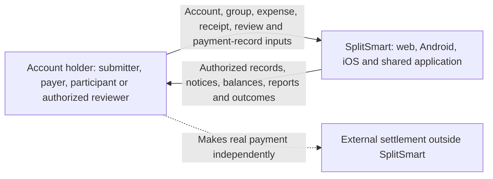
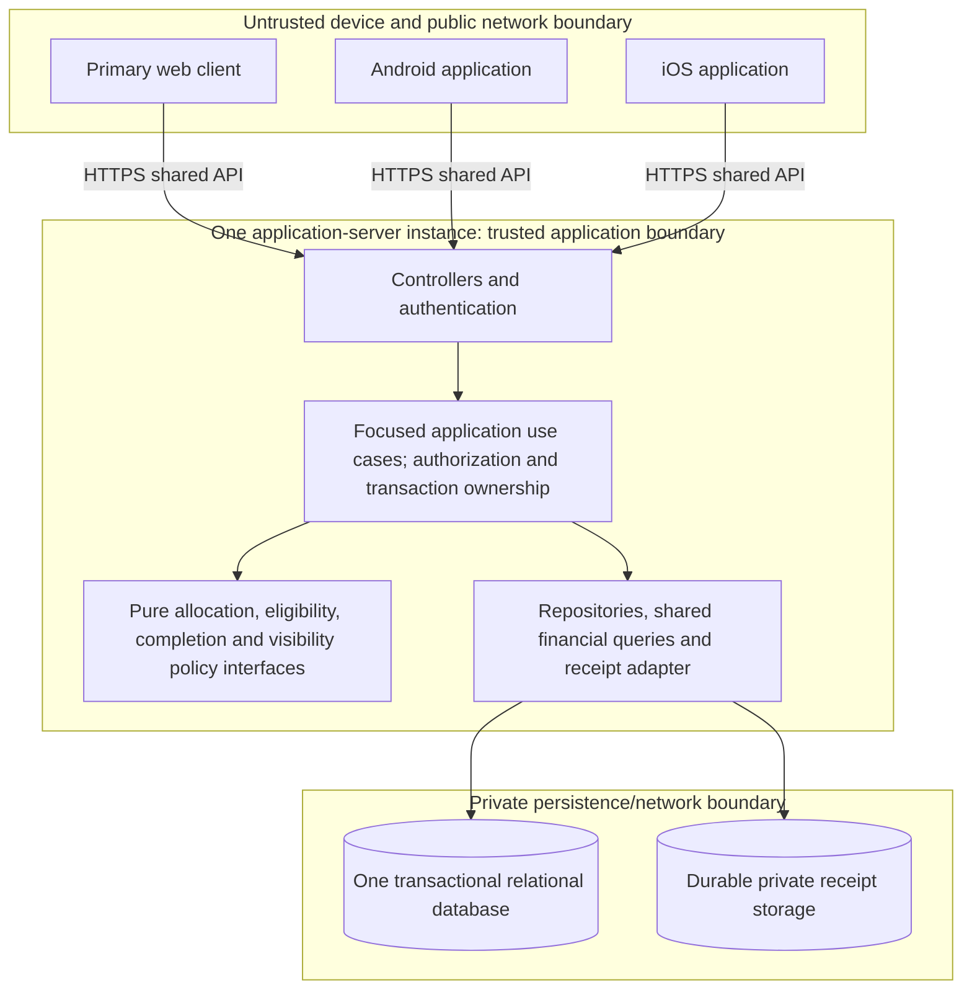

# SplitSmart final architecture — CIS 285 Lab 7

Date: November 5, 2026. Final documentation baseline; unresolved product policies prevent unconditional implementation acceptance. Scope is defined by [updated requirements](../requirements/updated_requirements.md), derived from the [original requirements](../../UserRequirement.md). All assumption/OQ identifiers refer to the [single register](../requirements/updated_requirements.md#assumption-and-decision-register).

## Selected architecture and authority

Follow [Architecture Decision: Selected Architecture](architecture_decision.md#selected-architecture) and [consolidated guardrails](consolidated_instructions.md#scope-and-architectural-guardrails): **Architecture B, layered application with derived balances**. [B §§1–6](architecture_b_codex.md) provides the topology, transactions, financial formula and security baseline. [A: Architecture and Responsibilities](architecture_a_speckit.md#architecture-and-responsibilities) contributes business ownership, isolated policy functions and historical attribution. The [review recommendation](architecture_review.md#recommendation-and-tradeoffs) explains the choice and gaps. A's posting step and earlier provisional financial-effect entity are superseded; no financial posting subsystem is carried forward.

## Context and trust boundaries

Legend: solid arrows are system information exchanges; dotted arrow is outside the system boundary and is not an integration. Contextual actors imply no privileges. Actual Android/iOS apps are required in addition to web (NFR-003); all use authoritative server rules and the same API (A5 connected baseline).

Legend: rectangles are logical runtime components unless labeled client/server instance; cylinders are durable stores; arrows denote allowed calls, not asynchronous messages or additional deployments. Web assets may be served by this server or static hosting; see [deployment](../design/deployment_design.md).

## Layers, business ownership and dependency contracts

Controllers parse requests, establish identity and map results/errors. They must not call repositories directly or select visibility/approval policy. Application use cases authorize every action/resource and own transactions. Shared rules depend on domain values and policy context, not HTTP or persistence. Repository interfaces are called by use cases; persistence adapters implement those contracts. Only adapters access the database or image store. Clients may provide early validation feedback but server validation is authoritative.

| Logical responsibility within the one server | Owns | Allowed collaboration |
|---|---|---|
| Accounts | User identity and authenticated context | Provides actor identity; does not grant group privileges. |
| Groups/authorization | Group records, membership history, scoped permission decisions | Supplies authorized contexts to every use case; membership is not a blanket grant. |
| Expenses/receipts | Expense, shares, private image association | Calls allocation policy and receipt adapter; coordinates submission with notice records in one DB transaction. |
| Review | ReviewDecision and expense review-state transitions | Locks expense; uses eligibility/completion policies; changes query eligibility without posting. |
| Financial queries/payments | Recorded payments and shared pairwise query definitions | Authorization scope precedes aggregation; consumes approved shares and recorded payments. |
| Notices | Per-recipient new-expense notification records | Participates in submission transaction; later retrieval reauthorizes; never adjusts balances. |
| Reporting | Authorized expense/balance/payment summaries | Reuses financial query definitions within one consistent snapshot; cannot duplicate arithmetic. |

These are ownership boundaries, not services. The submitting use case coordinates notification persistence through a shared unit of work; responsibilities cannot independently commit pieces of that command. Detailed operations, schema, data flows and read scope are in [detailed design](../design/detailed_design.md); entities are in [class diagram](../design/class_diagram.md); control flow is in [activity diagrams](../design/activity_diagram.md).

## Decisions and tradeoffs

| ID / status | Decision and origin | Benefit / cost |
|---|---|---|
| E1 — selected | Three tiers, one layered server, one transactional relational database; B §§1–2. | Shared rules and small deployment; single-instance availability limits and shared schema coupling. No broker or microservices. |
| E2 — selected | Derive balances from approved shares and recorded payments, B §4. | One financial source model; growing history increases read cost and makes query correctness essential. No balance table, posting subsystem or asynchronous financial projection. |
| E3 — selected | DB transactions, constraints, scoped idempotency, locking; B §§3–4. | Atomic operations and safe retries; lock contention and conflict handling must be designed. |
| E4 — selected | Private durable receipts and staged-upload coordination; B §§3/5. | Protects optional images; DB and independent image store cannot share an atomic commit. Cleanup/reconciliation required. |
| E5 — selected mechanism | Durable per-recipient notices commit with submission; B §3. A8 in-app retrieval/channel remains provisional. | No lost notice record after successful submission; writes grow with group size and saved notices are not proof of delivery. |
| E6 — selected refinement | Business ownership, pure policy seams, historical attribution, explicit failure contracts from A within B's layers. | Localizes change and verification; disciplined dependencies needed to avoid oversized use cases. No A posting mechanism. |
| EP1 — proposed, not selected | PostgreSQL as the relational implementation; B §§2/6. | Transaction/constraint/query fit; version, tooling, hosting and team fit need selection. No customer stack mandate. |
| EP2 — proposed, not selected | Shared mobile source packaged as Android and iOS apps; B §2. | Common presentation effort; separate builds, secure storage, device verification and distribution remain necessary. Framework unselected. |

No language, framework, cloud provider, supported version, hosting budget or mobile distribution method has been selected. Those are engineering decisions, separate from OQ-001–010 customer policy questions.

## Atomicity, consistency and failure boundaries

**SubmitExpense:** authorize and validate; if provided, stage a validated image durably and privately. Begin DB transaction, reserve scoped request key, stabilize membership reads using a common group lock protocol, and recheck context. Save pending expense, exact participant shares, optional receipt metadata referencing the existing staged object, and one notice for each other current group member. Commit all records together. Return success after commit. On rollback, no expense/shares/notices remain; the staged image is cleaned only after checking it is unreferenced. Promotion is a metadata/ownership change, not an unsafe post-commit move required for image availability.

**RecordReview:** authorize eligibility in the transaction, lock expense, resolve retry and current state, append decision, evaluate completion and update status atomically. Incomplete review remains `pending`; unsuccessful completion may be `declined` per provisional policy; completed approval becomes `approved`. Only this status change makes shares visible to financial queries. On conflict/rollback neither decision nor new status survives. Review-policy lifecycle remains OQ-007/008.

**RecordPayment:** authorize/validate an already-made settlement and any agreed acceptance conditions, reserve scoped key and insert once in one transaction. Lock relevant financial sources or serialize the user pair if future overpayment/confirmation policy depends on current totals; that policy is not selected. No transfer occurs and no balance row is updated. A confirmation workflow, if required by OQ-003, must refine the accepted-payment model before implementation.

**ReadBalances/ReadReports:** authorize scope before aggregation. A single query sees a committed consistent statement snapshot; multi-query reports use one repeatable read snapshot or equivalent. Group/person/unit/source scope is explicit. Filtered totals must not be called complete debts without OQ-009 resolution. Group-settled totals remain OQ-010. Historical records stay attributable independently of membership; this does not settle viewing rights or deletion policy.

Receipt storage failures block new receipt-bearing submissions; an already saved financial record stays saved if later image retrieval fails, with image-unavailable feedback. Database failure must not return save success. A lost response after commit is resolved by idempotent retry. Notice retrieval/delivery failure retries retrieval/delivery only, not expense creation, review or financial calculation.

## Security design

Authenticate every protected operation, then authorize action/resource on the server, including nested receipt, notice and aggregate requests. Derive actor IDs from authenticated context, not request claims. Recheck notification content and linked-expense visibility on retrieval. Scope queries before totals to avoid indirect disclosure; apply OQ-009 to historical data too.

Use HTTPS; secure session/token lifetimes and revocation according to the chosen identity scheme; protected cookie flags and CSRF defenses for cookie-authenticated mutations; restrict allowed origins when relevant. If passwords are managed locally, use established adaptive password hashing through the selected authentication framework, never reversible storage. Mobile tokens belong in platform-protected credential storage. Identity, recovery and closure policy remain OQ-006.

Use parameterized queries and least-privilege database/image credentials. Validate upload bytes/type/size against selected limits, use generated private object identifiers, reject executable content and path traversal, and authorize each image stream or short-lived access grant. Avoid public receipt URLs. Store secrets outside source control; rotate through controlled configuration. Log correlation IDs, operation/outcome and safe error categories without credentials, tokens, receipt contents or sensitive financial payloads. Account abuse controls and numeric limits require later engineering selection; no existing security implementation is claimed.

## Capacity and verification limits

Derived balance reads grow with relevant expense/payment history. Submission work grows with other-member notice count. Measure representative authorized queries and group-size writes after workload targets are agreed (OQ-005); inspect plans, targeted indexes and pagination first. Additional financial representations require a separately justified architecture decision and consistency design; they are absent here. No measured throughput, latency or high availability claim is made.

Proposed verification covers pure allocation/approval policies; real-database uniqueness, locks, snapshot reads and rollback; authorization for direct/aggregate/image/notice access; receipt/DB failures; history continuity; and every primary journey separately on web, Android and iOS. See [design verification scenarios](../design/detailed_design.md#proposed-verification-scenarios) and the [requirements consistency review](../requirements/updated_requirements.md#source-to-design-traceability-and-final-consistency-review). These are future checks, not executed application tests.
