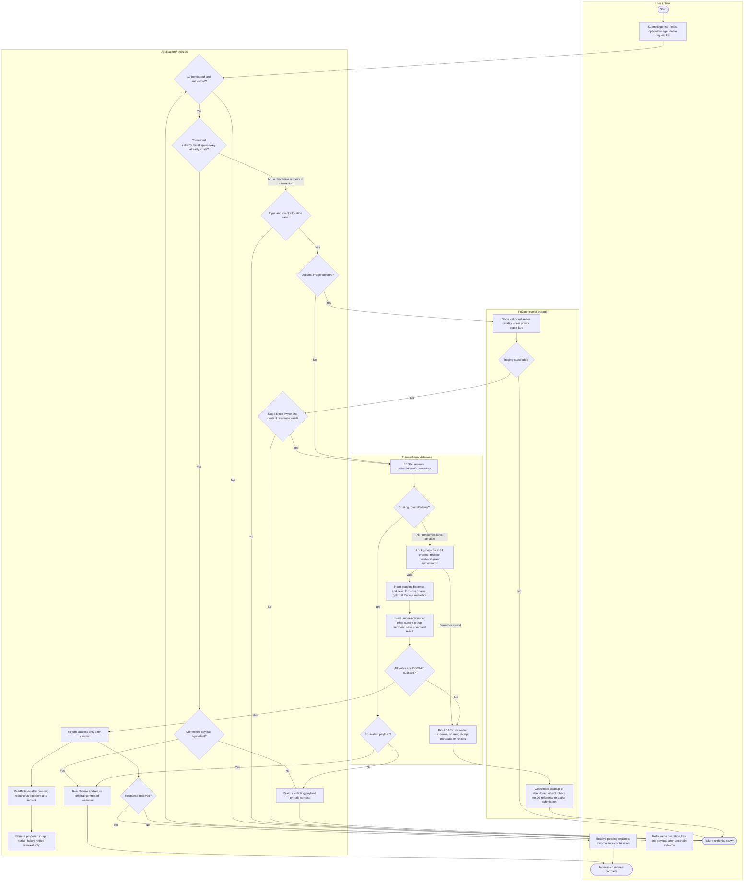
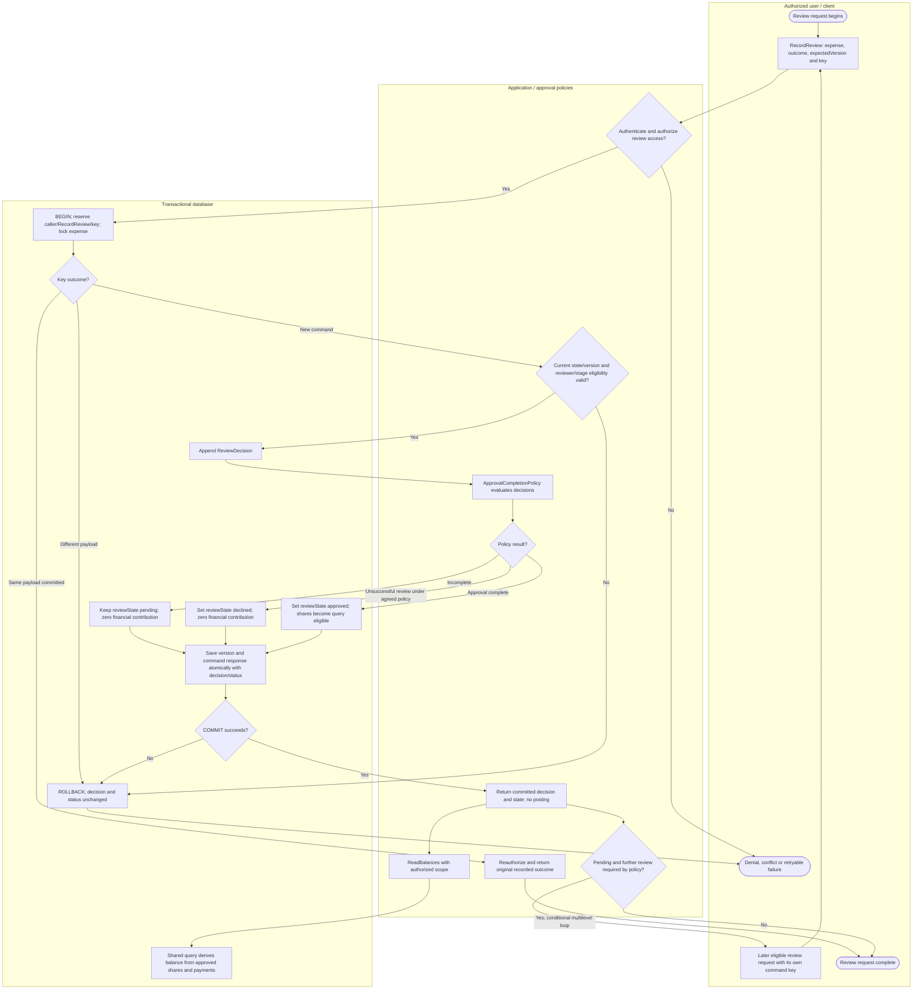
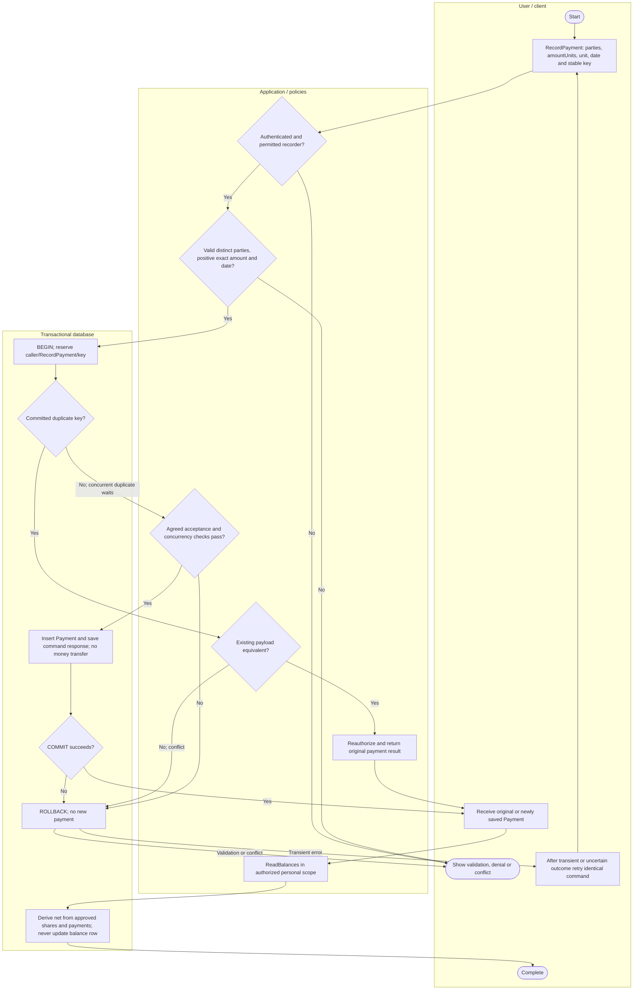
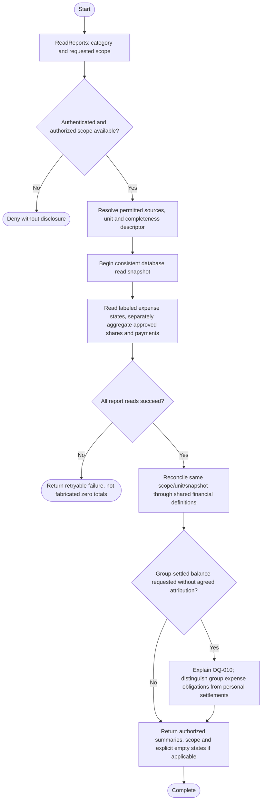

# SplitSmart activity diagrams — CIS 285 Lab 7

These editable Mermaid flowcharts express UML-style activities with partitions, action nodes, guarded decisions, loops and start/end nodes. Mermaid uses `flowchart` rather than a native UML `activityDiagram` keyword. This satisfies the explicit Mermaid request; it replaces the consolidated guidance's suggested PlantUML notation without changing behavior. Paste a fenced block into a Mermaid-capable Markdown preview/editor to render it.

Legend: rounded start/end nodes mark activity boundaries; rectangles are actions; diamonds are decisions; labeled arrows are guards/control flow; subgraphs are responsibility partitions. A transaction's BEGIN/COMMIT/ROLLBACK actions delimit database atomicity; receipt storage is outside that boundary. No parallel fork or distributed atomic commit is implied. The workflow can resume in later requests; a successful pending submission does not wait for review to return to the client.

Operations, fields and states match [detailed design](detailed_design.md), [class model](class_diagram.md) and [requirements](../requirements/updated_requirements.md). Policy IDs refer to the [single register](../requirements/updated_requirements.md#assumption-and-decision-register). Guards concerning eligibility/completion are conditional on agreed policies, not fixed reviewer roles, approval counts or permissions.

## SubmitExpense: review record and durable notices

Submission and notice retrieval are separate operations even though shown together. Notice records commit atomically with submission; actual delivery/retrieval is post-commit and provisional A8/OQ-004. A subsequent retrieval does not create another expense. If image bytes cannot be staged, do not save an attached submission or claim success. Staged objects are referenced without an indispensable post-commit file move. Cleanup also runs independently for abandoned uploads, using the same reference/active-submission checks; failure before database work can likewise leave an orphan. StageReceipt retries reuse their token when available. A mutation retry that lost its response resolves its command key before attempting a fresh submission or requiring a consumed stage token; the optional staging path above is for a new submission. DB/key/storage exceptions use the rollback or safe failure exits as applicable; no distributed transaction is implied.

## RecordReview: pending to approved or declined

Policy evaluation exceptions roll back the transaction. Review row locking serializes concurrent decisions; eligibility and completion are evaluated against the locked current record. An identical retry returns its original outcome; changed content under the same key conflicts. After lost response or transient failure, retry with the same key/payload; after a genuine stale-version conflict, refresh and deliberately choose a new command only if policy permits. New-key repeated decisions are evaluated as new decisions and may be rejected. Partial multilevel progress remains `pending`, with no invented stage count. Decline semantics, later resubmission, self-approval and individual-expense reviewers remain OQ-007/008. Approval commit changes query eligibility only; no balance table or financial posting is written.

## RecordPayment and subsequent balance retrieval

Lost responses also go to Retry with the same key. Same-payload duplicates do not insert again; different-key commands are distinct payments, subject to OQ-003. Permission, recipient confirmation, overpayment and correction rules are unresolved: the acceptance-check node cannot be implemented with arbitrary defaults. If confirmation is required, payment states/query inclusion need refinement first. OQ-010 prevents treating personal recorded payments as belonging to every group.

## ReadReports: authorized consistent summaries

This read uses application authorization/policies and DB query responsibilities as labeled actions; no receipt-store mutation is involved. The report shape is proposed; basic categories are mandatory while custom ranges/exports await OQ-001. Financial totals exclude pending/declined records even if those records appear in an authorized list. Filtered totals must not be represented as complete debts without resolving OQ-009. These are proposed workflows and future verification inputs, not runtime test results.
