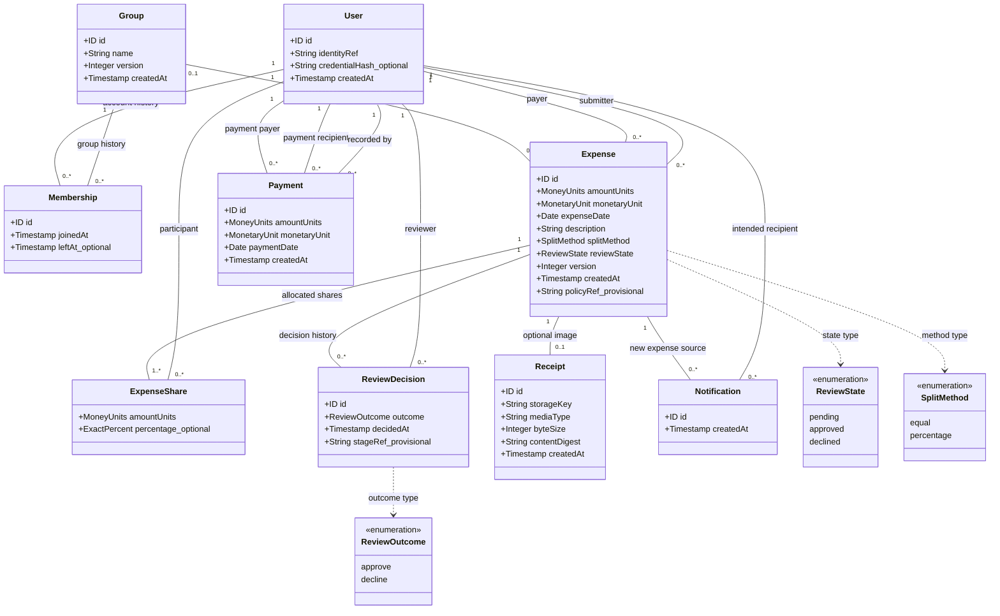
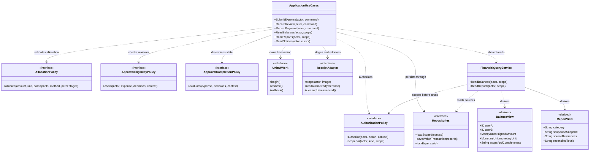

# SplitSmart UML class diagram — CIS 285 Lab 7

This editable Mermaid `classDiagram` follows [final architecture](../architecture/final_architecture.md) and the [detailed schema/contracts](detailed_design.md). Requirements and policy status are in the [shared register](../requirements/updated_requirements.md#assumption-and-decision-register). It is a conceptual model, not generated code or a selected ORM.

## Domain entities

Legend: `--` is an association, `..>` a type/dependency reference, quoted endpoints are explicit UML multiplicities (`1`, `0..1`, `0..*`, `1..*`). `+` denotes a conceptual public attribute, not permission to mutate it through the API. No composition diamond is used: deleting a group, membership or user must not imply deletion of financial history.

Each Expense has exactly one payer and submitter (possibly the same person), zero/one group, one or more participant shares and zero/one receipt. Each membership episode belongs to one group and one user, retaining joined/left history. Payer is allowed to participate under A2 but need not have a self-share. A Payment has distinct payer and recipient, one authenticated recorder and no group link under B; group settlement attribution remains OQ-010. A recipient may have many notices; one notice identifies one expense.

`MoneyUnits` is an exact integer-unit type; `ExactPercent` is exact decimal/rational, never binary float. Their concrete precision and residual rules await OQ-002. Sum(shares)=expense amount; percentage totals equal 100 for percentage splits. ExpenseShare identity is the composite expense/participant key. Pending and partially reviewed expenses stay `pending`; only `approved` shares enter balance queries; `declined` is provisional (A6). Review outcome/stage interpretation and policyRef binding await OQ-007/008. No automatic individual approval or fixed reviewer role is implied.

## Application services, interfaces and derived views

This is a dependency diagram rather than an instance association diagram, so multiplicities do not apply to its dashed dependency arrows. ApplicationUseCases abbreviates the separate focused operations and business owners detailed in [component contracts](detailed_design.md#component-contracts); Repositories abbreviates per-responsibility interfaces. Accounts, groups and notices retain their own focused use cases even though only representative operations appear here. Controllers call these operations and never repositories directly.

Entity/table mappings are User→users, Group→groups, Membership→memberships, Expense→expenses, ExpenseShare→expense_shares, ReviewDecision→review_decisions, Payment→payments, Receipt→receipts, Notification→notifications. Foreign-key fields are expressed by labeled associations to reduce duplication; their names/nullability appear in the data dictionary. Command-key retry metadata, upload staging details and identity-provider/session records are supporting storage concerns omitted from the domain drawing. BalanceView and ReportView are query results, **not persisted tables**. Policy interfaces define seams, not settled customer policy. Approved shares/payment history cannot be silently edited or deleted; correction operations remain OQ-003.

## Rendering

Open this Markdown in a Mermaid-capable preview, or copy each fenced block into a Mermaid editor supporting class diagrams. The source remains editable; no image replaces it. Use [activity diagrams](activity_diagram.md) for workflow semantics and [deployment design](deployment_design.md) for runtime nodes. Diagram rendering is a documentation check, not application verification.
