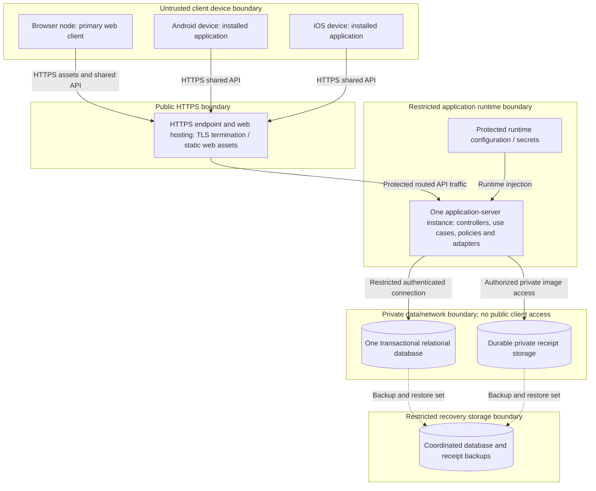

# SplitSmart deployment design — CIS 285 Lab 7

Date: November 5, 2026. Conceptual deployment only; no resources, builds or infrastructure configuration are generated. Follow [final architecture](../architecture/final_architecture.md) and the [shared requirements/decision register](../requirements/updated_requirements.md#assumption-and-decision-register). All original journeys run through the same server/API from web, Android and iOS.

## Deployment nodes and boundaries

Legend: boundary boxes group deployment/network trust zones; labeled device/server boxes denote runtime nodes with their logical software contents. Cylinders are durable data services/stores. Solid arrows denote runtime communication; dotted arrows denote operational backup/restore data paths, not financial processing. HTTPS endpoint/web hosting may be colocated with the application server; the diagram does not require a second application instance or a particular proxy product. TLS continues on routed connections where the hosting boundary requires it. DB and image store are distinct failure domains even if hosted together.

One server and database are selected architecture decisions (E1), not evidence of high availability. PostgreSQL is a proposal (EP1), and shared mobile source is a proposal (EP2). Language/framework, provider, OS/runtime/database versions, native versus shared mobile tooling, hosting budget and mobile distribution method remain unselected engineering choices.

## Environments, configuration and access

Propose isolated development, acceptance/test and production environments with separate databases, receipt namespaces, credentials and identity configuration. Do not copy real receipts, tokens or personal financial records into development fixtures. Use synthetic account/expense histories for acceptance. Release artifacts should identify compatible API/schema versions.

Serve web assets either from the same server or static hosting routed to the same HTTPS API. Set origin/cookie policy deliberately; cookie-authenticated state changes require CSRF defenses. Authentication method, identity provider/local-password decision, session lifetimes and registration/recovery/closure rules await OQ-006 and engineering selection. If using local passwords, only established adaptive password hashes are persisted. Mobile secrets/tokens use Android/iOS protected credential storage; app binaries must not contain server credentials.

Inject database credentials, identity signing keys and private storage credentials through protected runtime configuration, with least privilege, access separation, rotation and auditability. Avoid committing secrets. Restrict DB networking to the application runtime and controlled maintenance/backup identities. Receipt objects are private; clients receive images only after server authorization, through a protected stream or an authorized short-lived grant. Durable image storage is a private volume or object store, never ephemeral instance storage. Validate uploads before association.

## Platform builds, distribution and compatibility

Provide actual installable Android and iOS apps; responsive web alone is insufficient. Shared mobile source can reduce duplicated presentation work, but each platform needs its own build/signing configuration, permission handling, secure credential integration and acceptance run. Distribution via stores or managed/direct channels depends on institutional/customer constraints; certificates, signing ownership and review constraints require engineering decisions. Browser/Android/iOS supported versions remain OQ-005.

Clients share one documented API with exact numeric serialization and consistent authorization/error semantics. Deploy server changes compatible with supported installed client versions; mobile rollout may lag web/server rollout. Choose API versioning/deprecation rules before incompatible changes. Server is authoritative for approval, allocation and balances; cached screens refresh before claiming current results (A5). Offline editing/synchronization is not committed.

## Controlled releases and schema changes

Conceptual release procedure: review source-to-requirement and policy dependencies; validate candidate changes in isolated acceptance; identify supported clients and schema compatibility; obtain a coordinated recovery set; perform reviewed, versioned schema changes; deploy the compatible server/web build; verify health and account/group/expense/review/payment/report/receipt/notice smoke journeys; then distribute compatible mobile builds under the chosen process. This describes release controls rather than an implementation task list or executable deployment configuration.

Prefer additive schema/API evolution when clients or old server builds may coexist across a release. Assess data backfills and lock requirements before release. Destructive schema or policy changes require a specific reviewed migration and recovery plan; they are not authorized by this design. Application rollback is safe only if the previous release understands the resulting schema and persisted data. Reversing a migration or restoring a backup can lose later records; do not treat backup restoration as automatic rollback. No migration is supplied or run here.

## Backup, restoration and recovery verification

Back up the relational database and private receipt objects as a coordinated recovery set, including schema/API/build version and an object manifest/reference checkpoint. Their independent stores cannot share a DB atomic commit. Use a documented consistent snapshot/cutover strategy with write quiescence or equivalent coordination, capture already staged references safely, and retain enough objects to satisfy the DB recovery point. Include required configuration/key recovery through separately protected controls, not plaintext secrets in logs or manifests.

Restore into an isolated environment first: recover the compatible DB snapshot and image set; validate foreign keys and exact share totals; verify command-key metadata prevents replay duplicates; reconcile receipt references against objects; inspect approved/pending states, sample pairwise totals, reports and notices; verify authorized image access and visibility; then assess a controlled service cutover. A missing image is reported/recovered rather than causing financial history deletion. Do not silently discard post-backup records during a production recovery.

Recovery point/time objectives, backup cadence, retention, encryption/key-management implementation, restore rehearsal frequency and authority to delete data/backups remain OQ-005/006 and engineering decisions. No indefinite-retention or backup-deletion permission is inferred. A future restore exercise must provide evidence; this document claims no completed restore.

## Failure effects and operational runbook outline

| Symptom/dependency | User-visible effect and first response | Recovery boundary |
|---|---|---|
| Application server unavailable | API journeys stop; show service failure and retain stable keys for uncertain mutations. | Inspect safe health/error metrics, restore compatible runtime, then resolve mutation outcomes by identical retry. No automatic additional instance assumed. |
| Database unavailable or transaction failing | Writes cannot succeed; financial/report reads unavailable rather than false zeros. | Restore connectivity/compatible DB, investigate transaction conflicts, preserve key/history data; do not reinsert records manually to guess outcome. |
| Receipt store unavailable | Receipt reads fail clearly; new receipt-bearing submissions fail before commit. Other work may continue if its dependencies are healthy. | Restore store/access; reconcile references; preserve committed expenses. |
| Commit succeeded but response lost | Client cannot know outcome immediately. | Retry same caller/operation/key/payload to recover the original result; never mint a new key merely to retry. |
| Notice retrieval/delivery failure | Persisted notices may not yet be seen. | Retry retrieval or the agreed delivery mechanism; do not repeat expense submission or change balances. Delivery targets OQ-004. |
| Storage growth/orphaned upload backlog | Capacity risk or cleanup lag; no assumed numeric alert threshold. | Monitor DB/image/backup space and object/reference reconciliation; clean only confirmed unreferenced, inactive staged objects under agreed retention rules. |
| Security incident or credential exposure | Access integrity may be at risk. | Restrict affected access, rotate/revoke chosen credentials, preserve safe incident evidence; restore only through authorized controls. Specific identity mechanisms remain unselected. |

Operational logs contain correlation IDs, component/outcome and safe timing/error metadata, excluding passwords, session tokens, receipt contents and financial request bodies. Restrict log access and separate environment identifiers. Monitor health, error rates, lock/retry behavior, database storage, receipt availability, orphan cleanup and notice retrieval failures. Thresholds follow agreed workload/quality targets rather than invented numbers. A recovery run records symptoms, impacted dependencies, committed/uncertain operation outcomes, compatible recovery set, reference reconciliation and verification evidence before reopening service.

## Acceptance and remaining dependencies

Proposed deployment acceptance repeats every primary journey independently on agreed browser, Android and iOS versions, comparing the same saved authorized financial records after refresh (AC-018/019). Include secure mobile credential handling, HTTPS/authentication behavior, authorized image retrieval, notice access after membership changes, rollback compatibility and coordinated restore checks. DB integration and domain scenarios are in [detailed design](detailed_design.md#proposed-verification-scenarios).

OQ-005 blocks final environment/performance/capacity/recovery acceptance; OQ-006 blocks identity/upload/lifecycle configuration; OQ-004/009 govern notice delivery and visibility; OQ-002/003/007/008 govern financial/review acceptance; OQ-010 governs group settlement reports. Technology/provider/version/budget/distribution selections remain engineering proposals. The [requirements consistency checklist](../requirements/updated_requirements.md#source-to-design-traceability-and-final-consistency-review) records cross-document coverage. No implementation, provisioning or runtime testing is claimed.
