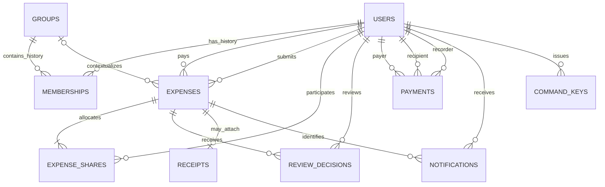
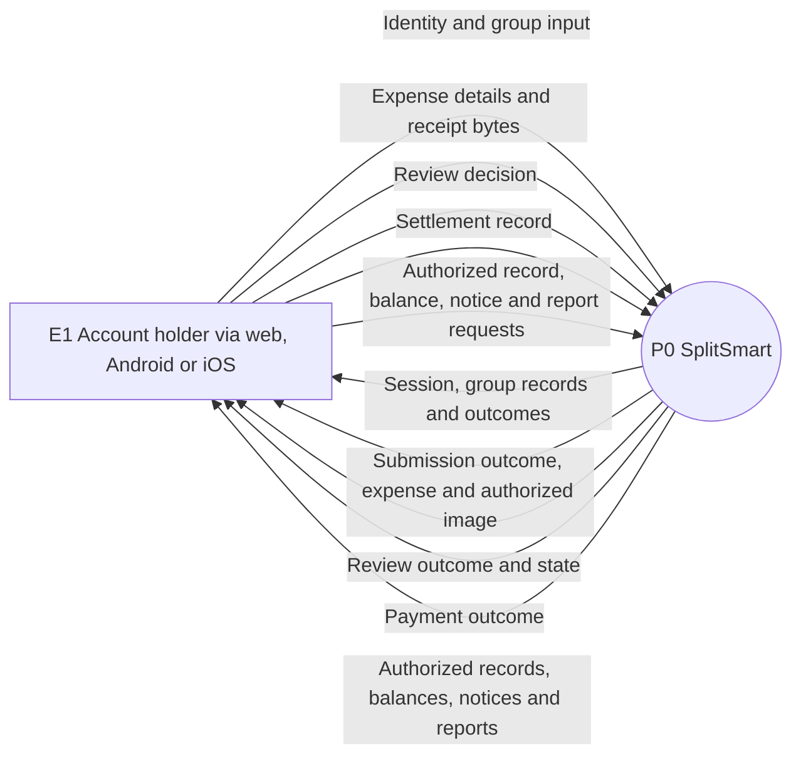
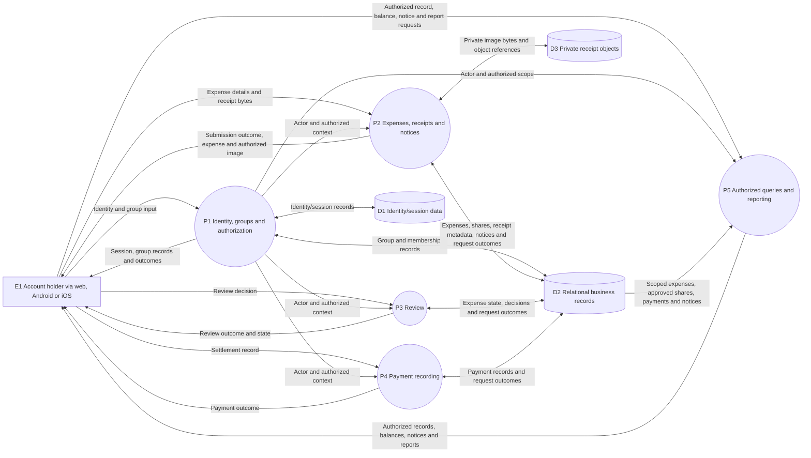

# SplitSmart detailed design — CIS 285 Lab 7

Date: November 5, 2026. Documentation baseline, not implemented software. Follow [final architecture](../architecture/final_architecture.md) and [updated requirements](../requirements/updated_requirements.md). The [shared assumption/decision register](../requirements/updated_requirements.md#assumption-and-decision-register) governs every provisional field/policy below. This file combines component, database and data-flow subjects requested by the consolidated guidance; no separate competing schema is created.

## Component contracts

All public operations below receive server-established actor/session context. Inputs are untrusted. Each application use case calls authorization/policy interfaces, owns its unit of work, and accesses data through adapters. Controllers map transport only; pure rules have no persistence dependencies. Clients render outcomes and refresh current state, using the same contracts on web, Android and iOS.

| Responsibility / operations | Inputs → outputs and owned data | Validation, authorization, dependencies and transaction/failure contract |
|---|---|---|
| Accounts: AccessAccount, Authenticate, ReadOwnAccount | Chosen identity credentials/reference → account/session or safe denial; owns users. | Identity adapter and user repository; identity uniqueness; account policy OQ-006. Account creation is atomic; retries must not create duplicate identity. Invalid credentials disclose no identity details. Recovery/closure operations conditional, not committed scope. |
| Groups: CreateGroup, ManageGroup, ReadGroup | Name, selected user IDs, requested membership change, expected version → group/membership history; owns groups/memberships. | Authorization policy and group/user repositories. A1 registered users; OQ-009 management/removal rules. Atomic mutation under group lock shared with submission recipient capture; stale version conflicts, no partial membership change. Conditional mutation list awaits agreed lifecycle. |
| Expenses: SubmitExpense, ReadExpense | AmountUnits, unit, date, description, payerId, participantIds, splitMethod, percentages, optional groupId/receiptToken, request key → pending Expense with exact shares. | Allocation/visibility policies, repositories, receipt adapter and notice writer. Unique participants, positive amount, valid unit/date/required fields, eligible references; OQ-002/009. Owns submission transaction including notices/receipt metadata; failed validation/transaction saves nothing. |
| Receipts: StageReceipt, ReadReceipt | Image bytes/type and authenticated upload context → private staging token; expense/receipt ID → authorized stream. Owns receipts metadata; adapter owns object lifecycle. | Validate actual image bytes and selected limits OQ-006; opaque token tied to actor/payload, single expense association. Read requires expense access. Object staging is outside DB transaction; failures block attached submission, orphan cleanup is reference-aware. Replayed committed submission returns existing receipt association. |
| Review: RecordReview | ExpenseId, decision outcome, expectedVersion, applicable stage reference if required, key → saved decision plus current reviewState/version. Owns review_decisions and authorized state transition. | Eligibility/completion policies, expense/review repositories, group context if needed. Lock expense and recheck policy/state. Append decision/update status atomically; partial remains pending; complete approval becomes approved; failed/declined has zero contribution. Retry returns original decision outcome; fresh decision must pass policy separately. OQ-007/008. |
| Payments: RecordPayment | PayerId, recipientId, amountUnits, unit, paymentDate, key → Payment. Owns payments. | Distinct valid parties, positive exact amount, recorder authorization OQ-003. Atomic insert/key persistence; future balance-dependent validation requires serialized pair checks shared with relevant approval changes. No money transfer. Confirmation/correction model must be refined if required. |
| Financial queries: ReadBalances | Actor, requested personal/group context → pairwise rows with amount, direction, unit, scope/completeness descriptor. Owns shared query definitions, no balance records. | Visibility scope before aggregation, expense/share/payment adapters. Approved shares only, no self-share debt. Personal cross-group completeness OQ-009; group settlement OQ-010. Read errors return no fabricated zero result. |
| Notices: ReadNotices | Actor, cursor/page size → authorized new-expense notices and next cursor; owns notifications. | Intended recipient plus current visibility check; private linked-expense content OQ-004/009. Insert in SubmitExpense transaction, unique expense/recipient; retrieval has no financial side effect. Delivery failures do not repeat submission. |
| Reporting: ReadReports | Actor, category and allowed scope; optional custom filters only after OQ-001 → labeled expense, balance, payment summaries and snapshot/scope metadata. Owns projections, no financial tables. | Uses shared financial query service and repositories under one consistent snapshot. Explicit pending/declined lists separate from approved totals. Report layout proposed; group net settlement conditional OQ-010; failure returns no misleading partial totals. |

Supporting contracts: authentication adapters establish identity, never business permission; persistence adapters expose scoped operations and join the caller's transaction without hidden commits; unit-of-work adapter owns begin/commit/rollback; receipt adapter supports private stage/read/reference checks and cleanup. Secrets and logs follow [architecture security](../architecture/final_architecture.md#security-design).

## Conceptual shared API and errors

Routes below are design examples, not implemented endpoints or a chosen framework. Protected requests carry the selected session/token; create commands use an `Idempotency-Key` header. `actorId` comes from authentication, even when party IDs are in the body. Exact values are serialized as integer-unit strings and exact decimal percentage strings, never binary floating-point JSON calculations.

| Operation / proposed route | Request → response |
|---|---|
| AccessAccount / POST /accounts; Authenticate / POST /sessions | Chosen identity fields → account reference or session context; details OQ-006. |
| CreateGroup / POST /groups; ManageGroup / PATCH /groups/{id} | Name/users or agreed mutation + expectedVersion → group/version. Mutation vocabulary conditional OQ-009. |
| StageReceipt / POST /receipt-stages | Image upload → opaque receiptToken; no expense yet. |
| SubmitExpense / POST /expenses | Fields in component contract → expenseId, reviewState=pending, shares, receipt reference, version. |
| ReadExpense / GET /expenses/{id}; ReadReceipt / GET /expenses/{id}/receipt | Resource reference → authorized record or protected image stream. |
| RecordReview / POST /expenses/{id}/reviews | Outcome, expectedVersion, policy-dependent stageRef → decisionId, reviewState, version. No client-selected reviewer identity. |
| RecordPayment / POST /payments | Payer/recipient, amountUnits, unit, paymentDate → paymentId and saved fields. |
| ReadBalances / GET /balances | Permitted scope → signed pairwise results and completeness label. |
| ReadNotices / GET /notifications | Cursor/page size → notices, nextCursor. |
| ReadReports / GET /reports/{category} | Expense/balance/payment category and authorized scope → records, reconciled totals, scope/unit/snapshot descriptor. |

Collection reads use bounded pagination with a stable tie-breaker ID and opaque cursor bound to actor/scope/query. Bounds are engineering configuration still to select, not numeric customer targets. Totals are over the authorized report scope rather than just a page; multi-page snapshot consistency must be disclosed or retained using a chosen snapshot strategy. Custom date ranges/exports are not mandatory query parameters.

Success is returned only after commit (conceptually 201 for creation, 200 for reads/replays). Error envelope: `category`, safe `message`, optional field errors, `correlationId`, and `retryable`. Categories: unauthenticated (401), denied/not visible (403 or nondisclosing 404), invalid input (422), idempotency conflict/stale version/invalid transition (409), unknown permitted resource (404), dependency unavailable (503). Operational failures never masquerade as empty successful reports. No raw DB, image key or credential errors reach clients. Retry unavailable/unknown-outcome mutations with the same key and payload; fix validation/conflicts deliberately rather than blindly resubmitting.

## Pure policy interfaces and lifecycle seams

- `AuthorizationPolicy.authorize(actor, action, resourceContext)` returns allow/deny plus an internal reason. `scopeFor(actor, queryKind, requestedScope)` returns allowed records and completeness semantics. Membership alone does not grant access.
- `AllocationPolicy.allocate(amountUnits, monetaryUnit, participants, method, exactPercentages)` returns exact share units summing to amount, or structured validation error. Currency precision and deterministic residual distribution await OQ-002.
- `ApprovalEligibilityPolicy.check(actor, expense, decisions, policyContext)` determines eligibility for this decision/stage, without implicit self-approval.
- `ApprovalCompletionPolicy.evaluate(expense, decisions, policyContext)` returns `pending`, `approved` or provisional `declined`, plus any policy-dependent next-stage context. Counts, roles and stage completion remain OQ-008; individual expenses also invoke this interface.

Policy establishment, version binding, changes to in-flight expenses and resubmission remain OQ-007. A provisional policy reference/version field is an extension seam, not a chosen snapshot/current-policy behavior. Missing/unresolved production policy must not silently allow a command. Named single-review/multilevel test fixtures may exercise interfaces but cannot become customer defaults. No workflow configuration tool is committed.

## Command identity, concurrency and atomic transitions

Use a logical command-key record with unique `(actorId, operation, requestKey)`, canonical payload fingerprint, result reference, and original committed response fields. This is technical retry metadata, not a financial posting. Persist it in the same transaction as the mutation. Equivalence includes all semantically relevant fields and target IDs; normalize only representations that have the same defined meaning. For a receipt include the stable upload/content reference, not a changing transport URL. Do not infer a retry from matching amount/date alone.

An identical committed retry is reauthorized before returning its saved outcome and returns the original command result without another mutation; current state may be fetched separately. A changed payload under the same key conflicts. Concurrent identical requests serialize on key uniqueness: one commits; the other reads the committed result. If the first rolls back, a retry may perform the command. Transient deadlock/serialization retry restarts the entire transaction with the same key. Cleanup/lifetime of retry metadata is an engineering retention decision; do not expire keys in a way that permits accidental duplicate financial records.

Submission reserves key, locks group context when present, validates participant references and current membership according to policy, records exact shares and pending expense, attaches pre-staged image metadata, creates unique notices and saves response before commit. ManageGroup takes the same group lock, making the recipient set coherent at submission. Lock ordering across key/group/expense resources must be consistent in implementation.

Review reserves key, locks expense, checks expectedVersion and current authorization/eligibility, appends a decision and updates status/version in one transaction. Same-key retries resolve before stale-version rejection. Different keys are distinct decisions: policy prevents repeated actor/stage decisions where disallowed, even if the payload looks alike. Finalized-state decisions conflict unless a future agreed lifecycle explicitly permits them. Concurrent reviewers serialize; a second command reevaluates the committed decisions, cannot independently approve stale state. ReadBalances simply includes each approved share once; there is no second financial write.

Payment reserves key and inserts one accepted recorded payment. If OQ-003 selects confirmation, the design must define acceptance states and exclusion rules before implementation; the present baseline assumes a successfully authorized record is financial. Overpayment policy is unresolved; no rule permitting or rejecting it is implied. Any future current-balance check needs transaction-level concurrency protection against both payments and approval changes affecting that pair, rather than a stale read.

Approved shares and recorded payments cannot be silently edited/deleted. All changes affecting historical totals require an explicit authorized correction policy and preserved provenance under OQ-003. This design introduces neither correction endpoints nor a ledger. Group/membership/user deletion must not cascade into financial history; account deletion/privacy requirements need reconciliation under OQ-006 before implementation.

## Logical database schema and data dictionary

Exact monetary type `MoneyUnits` means arbitrary/sufficient-width integer units at the agreed precision; concrete width and precision await OQ-002. `ExactPercent` is an exact decimal/rational value with agreed input precision, not float. `MonetaryUnit` identifies the agreed currency/precision; do not silently assume dollars. IDs are opaque stable keys; concrete type is unselected. Unless marked nullable, fields are required. `createdAt` timestamps are server-generated. Proposed fields support design, not additional customer policies.

| Table / owner | Fields, keys and nullability | Constraints and historical behavior |
|---|---|---|
| users / Accounts | id PK; identityRef unique; credentialHash nullable for externally authenticated identities; createdAt | Identity format/provider OQ-006; password hash only if local credentials; references preserved, no cascade delete. |
| groups / Groups | id PK; name; version; createdAt | Nonempty name (A1); lifecycle/uniqueness naming rules undecided. |
| memberships / Groups | id PK; groupId FK; userId FK; joinedAt; leftAt nullable | Historical episodes; leftAt ≥ joinedAt if set; at most one active episode per group/user; no financial cascade. Role fields not invented. |
| expenses / Expenses, Review owns state | id PK; submitterId FK users; payerId FK users; groupId nullable FK groups; amountUnits; monetaryUnit; expenseDate; description; splitMethod; reviewState; version; createdAt; policyRef nullable/provisional | amountUnits > 0; splitMethod equal/percentage; state pending/approved/declined; one payer A2; policy binding OQ-007/008. Approved data protected from silent change. |
| expense_shares / Expenses | expenseId FK; participantId FK users; amountUnits; percentage nullable | Composite PK (expenseId,participantId); amountUnits ≥ 0 because tiny exact allocations may include zero shares; percentage required only for percentage split; exact cross-row sums checked transactionally. |
| review_decisions / Review | id PK; expenseId FK; reviewerId FK users; outcome; decidedAt; stageRef nullable/provisional | Outcome vocabulary approve/decline proposed; stage/eligibility/uniqueness per policy OQ-008; append decision and state atomically. Key deduplication via command_keys. |
| payments / Payments | id PK; payerId FK users; recipientId FK users; recordedById FK users; amountUnits; monetaryUnit; paymentDate; createdAt | amountUnits > 0; payerId ≠ recipientId; no groupId in B. Confirmation/correction OQ-003; group attribution OQ-010. No silent update/delete. |
| receipts / Receipts | id PK; expenseId unique FK; storageKey unique; mediaType; byteSize; contentDigest; createdAt | One optional receipt per expense; positive size, validated content; private opaque key; no public URL. Staging metadata may exist separately before association. |
| notifications / Notices | id PK; recipientId FK users; expenseId FK; createdAt | Unique (expenseId,recipientId) for new-expense notice; recipient snapshot independent of later membership. Content reauthorized on read. Read/delivery state fields conditional on OQ-004. |
| command_keys / Unit of work, technical | actorId FK; operation; requestKey; payloadFingerprint; resultRef; savedResponse; createdAt | Composite PK (actorId,operation,requestKey); same transaction as command; resultRef is logical, not an untyped substitute for financial FKs. Store safe minimal response metadata. |

Foreign keys use restrictive deletion for financial/historical references. Policy may later authorize privacy-preserving lifecycle handling; indefinite retention is not assumed. Optional staging metadata must bind token to actor/content, track reference state and support cleanup coordination; final physical storage structure remains an adapter choice. Session/provider-specific tables are omitted because identity technology is unselected.

Proposed indexes: expenses(reviewState,payerId,monetaryUnit), expenses(groupId,expenseDate,id), expense_shares(participantId,expenseId), review_decisions(expenseId,decidedAt,id), payments(payerId,recipientId,monetaryUnit,paymentDate,id) and reverse-party access where needed; memberships(groupId,userId,leftAt) and user membership lookup; notifications(recipientId,createdAt,id). PK/unique constraints also index command keys, participant shares and notice identity. Verify plans before adding redundant indexes.

Cross-row invariants are not ordinary row checks: participant shares sum to expense amount; percentage values total exactly 100; unit matches parent; each selected participant has one share; group eligibility is policy checked; notice recipients equal the captured other-current-member set. Enforce in the transaction under coordinated writes and appropriate constraints. For equal splits, percentage is null. Payer may have a share but need not; no payer self-obligation is generated. Multiple currencies, if later selected, must stay separated in queries with no implicit conversion.



ER legend: `||` exactly one, `o|` zero or one, `o{` zero or many, `|{` one or many. Relationships describe cardinality, not cascade deletion. Full attributes are in the dictionary and [class diagram](class_diagram.md).

## Financial query definition, scope and worked examples

For distinct users A and B, positive `net(A,B)` means **B owes A**:

```text
sum(B's shares of approved expenses paid by A)
- sum(A's shares of approved expenses paid by B)
- sum(payments from B to A)
+ sum(payments from A to B)
```

`net(B,A) = -net(A,B)`. Display each unordered pair once, with direction derived from sign; zero means no outstanding obligation. Exclude payer self-shares. No third-person debt simplification occurs. Aggregate authorized expense/share sources and payment sources separately before combining; joining raw expense shares to raw payments multiplies rows and is invalid.

Conceptual query pseudocode (not executable SQL):

```text
scope = AuthorizationPolicy.scopeFor(actor, queryKind, requestedScope)
begin consistent read snapshot
expenseTotals = group approved expense shares by canonical pair and monetaryUnit
    where expense/share source is authorized in scope and payer != participant
    signed positive if payer == canonical A else negative
paymentTotals = group authorized recorded payments by same pair and monetaryUnit
    signed negative if payer == canonical B else positive
netRows = union pair/unit keys from both totals
    combine coalesce(expenseTotal, 0) + coalesce(paymentTotal, 0)
return netRows with scope, unit and completeness descriptor
end snapshot
```

For a personal request, include only obligations within the authorized personal scope, potentially across groups and groupless records if OQ-009 allows. Do not call privacy-filtered totals complete debts. Group expense reports filter expenses by group; group-settled balances cannot be derived by assigning every pair's payment to each group. Until OQ-010 resolves attribution, label group results as approved expense obligations before settlement and present separate authorized personal payment/balance summaries. No global all-users access is implied. A report containing several queries uses one repeatable read snapshot or equivalent, and its authorized scope and policy context must remain coherent for that response.

Examples assume an abstract monetary unit divisible exactly for the stated amounts; they establish no currency or rounding rule:

| Case | Expected result |
|---|---|
| Alice pays 90 equally for Alice/Bob/Cara, pending | Stored shares 30 each; Bob/Alice and Cara/Alice financial totals remain zero. |
| Same expense approved | Bob→Alice 30; Cara→Alice 30; Alice's self-share 30 generates no debt. |
| Bob records payment 10 to Alice | Bob→Alice becomes 20; Cara remains 30. |
| Replay same payment command | Same payment row/result; Bob still owes 20. |
| Bob records a genuinely new payment 20 | Bob→Alice becomes zero. |
| Separate approved 100 paid by Alice at 50/30/20 percent for Alice/Bob/Cara | Shares 50/30/20; Bob→Alice 30; Cara→Alice 20; self-share excluded. |
| Separate opposing expenses: Bob owes Alice 30, Alice owes Bob 12 | One net obligation Bob→Alice 18. |
| Pending, partial review or declined 90 | No financial contribution irrespective of stored shares. |
| Empty authorized scope | Empty source lists, explicit no activity, zero outstanding; no fabricated payment/expense. |
| 100 equally split three ways | Exact-sum allocation required, but which participant gets a residual unit awaits OQ-002; no fractional result is asserted. |

## Receipt and notice failure coordination

Validate and durably stage image bytes before DB submission; the stable private object can remain at its key after commit. Receipt metadata becomes the authoritative association. Cleanup checks DB references and upload ownership/state under a coordination protocol so it cannot race an active submission; do not delete merely because an object is old. Age thresholds and retention remain open engineering/OQ-005 inputs. Failed DB transactions leave unreferenced objects for cleanup; failed image upload leaves no expense save. Periodic reconciliation identifies referenced-but-missing and unreferenced objects. Missing referenced images generate operational alerts and image-unavailable feedback, not financial deletion or false submission retries. Database and independent image store cannot atomically commit together.

Notice uniqueness prevents duplicate recipient records. The expense, shares, receipt metadata and notices commit or roll back together. Later client retrieval rechecks recipient and visibility; failure retries only that retrieval. If another delivery channel is chosen, its retry/state design needs refinement under OQ-004, without a broker requirement or financial side effect.

## Context and balanced level-one data flows

These diagrams show **data movement**, not activity sequencing or control decisions. External entity E1 is the account holder using any supported client; P0 is the whole system; P1–P5 are logical processes within the server; D1–D3 are stores. Bidirectional arrows denote both named input and output data flows. D1 contains identity/session metadata as needed, D2 the relational business tables (including command keys); both are logical stores in the same one database. D3 is private receipt storage.





Balance check: the same five named external request/response pairs appear at P0 and across P1–P5. Receipt reads use P2's authorized image response; query metadata lists use P5. Authorization context is an internal data flow, not an implied access grant. No external bank, push provider, projection store or financial posting process is introduced.

## Proposed verification scenarios

No application, migrations, tests or deployment resources are generated, and none of these scenarios has been executed against software.

| Area | Scenario and expected evidence | Requirement / open dependency |
|---|---|---|
| Domain | Both split methods, invalid totals/participants, self-shares, pending exclusion and opposing debts match examples. Fractional fixture only after monetary policy. | FR-005–008/011/013; OQ-002. |
| DB integration | Concurrent same-key commands yield one saved result; changed payload conflicts; rollback at each write leaves no partial submission/notice/payment. | FR-016. |
| Review concurrency | Two final reviewers serialize; decision/status commit together; replay differs from a new decision; incomplete multilevel fixture stays pending. | FR-011/012/016; OQ-007/008. |
| Query correctness | Several shares and several payments do not multiply totals; empty scope and separate units correct; report queries use one snapshot. | FR-013/015, NFR-002. |
| Authorization | Cross-user direct ID, receipt, notice, report and aggregate attempts denied; current/former-member fixtures use explicit policies with no inferred privileges. | FR-002/004/009/015; OQ-009. |
| Historical continuity | Permitted membership change does not rewrite old attribution or financial sources; saved records survive login. | FR-017; OQ-003/006/009. |
| Storage failures | Upload failure prevents save; DB rollback leaves cleanable orphan; committed image cannot be swept during submission; missing image does not delete expense. | FR-009/016. |
| Notification failures | Commit creates unique captured-recipient notices; retrieval failure/retry does not resubmit expense; visibility rechecked. | FR-010; OQ-004/009. |
| Platform | Primary journeys on browser, Android and iOS; reopening same records produces matching scoped totals. Shared mobile source is not test evidence. | NFR-003/005; OQ-005. |
| Operations | Restore coordinated DB/image backups, identify missing references, verify version compatibility and secrets isolation. | Deployment design; OQ-005/006 and engineering stack selection. |

Final traceability and remaining decision dependencies are maintained in the [requirements consistency review](../requirements/updated_requirements.md#source-to-design-traceability-and-final-consistency-review).
