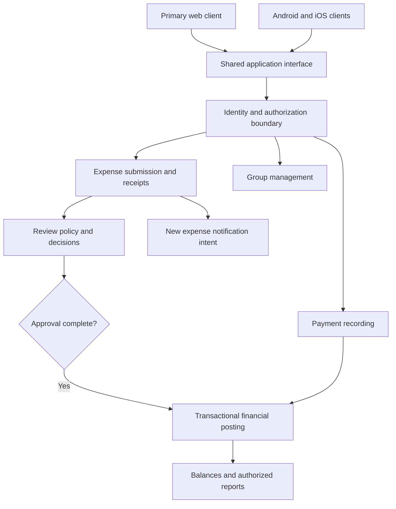

# Implementation Plan: SplitSmart Expense Sharing

**Branch**: `lab7-architecture-design` | **Date**: 2026-11-05 | **Spec**: [spec.md](spec.md)

**Input**: [UserRequirement.md](../../UserRequirement.md), with Q1/Q2 clarifications recorded in the specification.

## Summary

Plan a primary web experience and Android/iOS applications for accounts, groups, expense submission, notifications, review, balances, payment recording, and reports. Expenses have no balance effect until review and approval complete. Group management and access are governed by an eventual authorization policy.

This is a provisional architecture, not an implementation-ready commitment. Customer policy questions remain open by explicit instruction. Technical proposals below explain how independent design can proceed without answering those questions. No application code or deployment is included.

## Technical Context

**Language/Version**: Deferred technical selection; the source specifies no language or version.

**Primary Dependencies**: Deferred; authentication, receipt storage, and notification delivery need implementation choices after their scope is agreed.

**Storage**: Proposed transactional relational storage for accounts and financial records; private image storage for optional receipts. Vendor and schema technology remain unselected.

**Testing**: Proposed domain unit tests, transactional integration tests, authorization contract tests, and web/Android/iOS journey tests; framework deferred.

**Target Platform**: Primary web plus Android and iOS apps. Browser/OS support matrix remains OQ-005; no assumption that a responsive website alone fulfills the app requirement.

**Project Type**: Proposed shared backend with web and mobile clients.

**Performance Goals**: Not specified; OQ-005. No invented latency, load, or availability target.

**Constraints**: Approval before balance impact; authorized visibility; equal/percentage allocations; optional receipts; cross-platform persisted records. Monetary rules remain OQ-002.

**Scale/Scope**: All nine original feature headings. Capacity unspecified. Custom reports remain optional scope awaiting OQ-001.

## Constitution Check

The constitution is an unfilled template and supplies no adopted gates. Before and after design review: no adopted constitutional rule can be evaluated or claimed satisfied.

Source-fidelity check passes: all original capabilities are traced in SC-001, and proposed technical choices are separated from customer requirements. Policy-completeness gate remains open: OQ-008/OQ-009 and other material questions prevent final implementation readiness. The user explicitly authorized provisional planning with these decisions unresolved; this is an exception to the planning skill's default requirement to resolve every clarification. It is not a claim that the questions are answered.

## Architecture and Responsibilities

Use a proposed modular backend so the clients share authorization, allocation, review, and balance behavior. These are logical modules, not a requirement for separate deployed services.

| Boundary | Responsibility | Source/constraint |
|---|---|---|
| Accounts | Identity and authenticated session context | FR-001–002; lifecycle OQ-006 |
| Groups and authorization | Group operations and action/resource access decisions | FR-003–004; OQ-009 |
| Expenses and receipts | Validated submitted expense and optional image association | FR-005–009 |
| Review | Review history and completion decision through an approval-policy interface | FR-011–012; OQ-008 |
| Financial records | Approved expense effects, recorded payment effects, pairwise balances | FR-013–014/016–017 |
| Notifications | Notice of newly created group expenses | FR-010; channel OQ-004 |
| Reporting | Authorized summaries consistent with financial records | FR-015; custom scope OQ-001 |



The diagram shows processing responsibilities, not granted permissions. Reviewers, membership managers, former-member rights, and self-approval are unresolved. A group creator is not assigned an administrator role by this design.

### Approval and Financial Consistency

Persist a submitted expense as a review record, separate from the approved financial effects. Partial reviews, unsuccessful reviews, and pending submissions contribute zero to balances. An approval-policy boundary answers eligibility and completion for the selected workflow. It can represent one review or multiple levels without fixing counts, roles, self-approval, or a user-facing workflow configuration feature.

Propose storing a unique source reference with each financial posting and committing approval completion plus financial effects atomically. Concurrent completion attempts must result in one effect. Retrying a recorded payment must likewise preserve a single effect. Policy version binding is a design question under OQ-007, not an adopted rule for in-flight expenses.

### Authorization and Membership

Authorize every group mutation and financial read at the shared backend, including receipts and reports. Client visibility is not the security boundary. Keep record attribution independent of current membership so removal need not erase financial history. This does not decide whether removal is allowed or whether a former member can read that history.

Notification recipient selection follows the source's other-group-members requirement. Notification content must respect eventual visibility rules; where those rules conflict, resolve OQ-004/OQ-009 before deciding whether notices include financial details or merely identify a newly created expense.

### Failure Boundaries

Validate allocations before accepting submission. Persist the expense and a notification delivery intent together as a proposed reliability mechanism; delivery retries do not recreate expenses or adjust balances. Delivery channel, deadlines, and retry limits remain open. Receipt upload failure must be visible and must not produce a falsely successful submission. Notification delivery failure is distinct from financial approval.

## Project Structure

### Documentation (this feature)

```text
specs/001-splitsmart-specification/
├── spec.md
├── plan.md
├── research.md
├── data-model.md
├── quickstart.md
├── contracts/
│   └── application-boundaries.md
└── checklists/
    └── requirements.md
```

### Source Code (proposed; not created)

```text
backend/
  src/{accounts,groups,expenses,review,financial,notifications,reporting}/
  tests/{unit,integration,contract}/
web/
  src/
  tests/
mobile/
  src/
  tests/
```

**Structure Decision**: One shared backend and separate web/mobile presentation boundaries. The mobile directory does not decide native versus shared mobile implementation. Final stack selection may refine the layout.

## Delivery Sequence and Decision Gates

1. Agree technical stack and monetary representation; define account identity and environment setup.
2. Build accounts and persistence foundations, then group/expense interfaces with explicit policy seams.
3. Resolve OQ-008/OQ-009 before implementing production reviewer eligibility, completion rules, membership changes, and visibility. Test fixtures may explore named policy alternatives without making them defaults.
4. Implement transactional financial effects and payment recording after OQ-002/OQ-003 settle their rules.
5. Integrate notifications and receipts after OQ-004/OQ-006; reporting and platform journeys follow the same authorized records.
6. Validate the accepted browser/OS matrix and quality targets after OQ-005. Resolve OQ-001 before committing custom reports.

These are architecture dependencies, not a generated task list. Changes to open policies may require data-model and contract revisions. Recheck the specification and checklist before implementation.

## Complexity Tracking

No adopted constitutional violations identified. A modular backend is proposed because no source requirement establishes independent service deployment. Distributed services would add coordination without a confirmed need.
